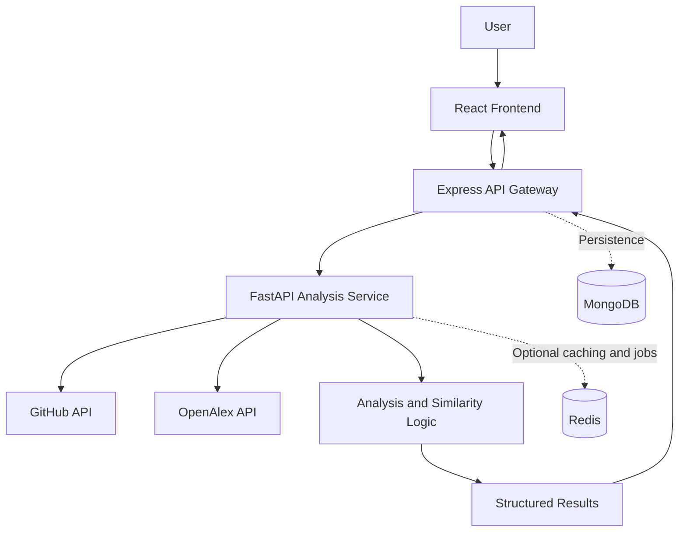

# InnoGap — Discover Before You Build

**An innovation intelligence platform for exploring existing solutions, identifying research gaps, and making better-informed decisions before building something new.**

[]()
[]()
[]()
[]()
[]()
[]()

---

## Overview

Have an innovative idea but don't know whether someone has already built it?

**InnoGap helps innovators investigate what already exists before investing time and effort in building something new.**

It aims to bring together relevant software projects, research publications, and analytical insights to help users understand the existing landscape around an idea and identify opportunities for further innovation.

Instead of manually searching multiple platforms and comparing results independently, InnoGap aims to streamline the discovery and analysis process through a unified application.

InnoGap is being developed with students, researchers, developers, and aspiring innovators in mind.

## The Problem

Innovators often face several challenges when exploring a new idea:

- **Fragmented discovery:** Relevant information is spread across software repositories, academic publications, and other sources.
- **Duplicate effort:** Similar solutions may already exist, but discovering them can be difficult.
- **Time-consuming research:** Manually searching, comparing, and evaluating existing work takes time.
- **Unclear opportunities:** Understanding what existing solutions lack requires more than simply finding similar projects.

## Our Approach

InnoGap aims to make early-stage innovation research more accessible through a structured discovery and analysis workflow.

1. **Submit an idea** — Describe the problem, concept, or proposed solution you want to investigate.
2. **Discover existing work** — Search relevant sources for potentially related projects and publications.
3. **Analyze similarities** — Examine how discovered work relates to the submitted idea.
4. **Explore potential gaps** — Identify limitations, differences, and areas that may warrant further investigation.
5. **Review the results** — Use the findings to guide further research and development decisions.

*The availability and completeness of individual capabilities depend on the current development stage.*

## Key Features

The following describes InnoGap's intended capabilities; features should be considered available only when implemented and verified.

- **Idea-based discovery:** Explore existing work relevant to a proposed innovation.
- **Software repository analysis:** Discover potentially related projects using sources such as GitHub.
- **Academic research discovery:** Explore relevant research publications using sources such as OpenAlex.
- **Similarity analysis:** Help compare a proposed idea with existing solutions.
- **Research gap exploration:** Highlight potential differences and opportunities for further investigation.
- **Unified results:** Present findings in a structured format for easier review.
- **Analysis history:** Support persistent storage and retrieval of previous analyses as the feature is implemented.

## Architecture

InnoGap is being developed with a modular architecture that separates the user interface, API layer, and analysis workflow.



### Component Responsibilities

| Component | Responsibility |
|---|---|
| React | User interface and presentation of analysis results |
| Express | API entry point, request validation, and communication with the analysis service |
| FastAPI | Analysis workflow, external data retrieval, and processing |
| GitHub API | Discovery of relevant software repositories |
| OpenAlex API | Discovery of relevant scholarly works |
| MongoDB | Persistent storage for supported application data and analysis history |
| Redis | Optional caching and background processing, if implemented |

**Architecture note:** This diagram represents the target architecture. The exact deployment and data flow should be updated to reflect the implementation currently present in the repository.

## Technology Stack

| Area | Technology |
|---|---|
| Frontend | React |
| Landing page | HTML, CSS |
| API backend | Node.js, Express |
| Analysis service | Python, FastAPI |
| Database | MongoDB |
| External integrations | GitHub API, OpenAlex API |
| CI | GitHub Actions |
| Optional infrastructure | Redis |

## Getting Started

Follow these instructions to set up InnoGap locally. The commands assume a repository with separate frontend, Express backend, and FastAPI service directories. Adjust the paths to match the actual repository structure.

### Prerequisites

Install the following tools:

- Git
- Node.js and npm
- Python and pip
- MongoDB, if your current application requires it
- A code editor such as Visual Studio Code

Redis is optional unless your implementation depends on it.

### 1. Clone the repository

```bash
git clone <YOUR_GITHUB_REPOSITORY_URL>
cd InnoGap
```

Replace the placeholder with your repository's actual URL.

### 2. Set up the React frontend

```bash
cd frontend
npm install
npm run dev
```

Run the commands supported by your frontend's `package.json`. The development command may differ depending on your build tool.

### 3. Set up the Express backend

Open another terminal:

```bash
cd backend
npm install
```

Configure the required environment variables and start the backend using the script defined in its `package.json`, for example:

```bash
npm run dev
```

### 4. Set up the FastAPI analysis service

Open another terminal:

```bash
cd analysis-service
python -m venv .venv
```

Activate the virtual environment.

**Windows PowerShell:**

```powershell
.venv\Scripts\Activate.ps1
```

**macOS/Linux:**

```bash
source .venv/bin/activate
```

Install dependencies:

```bash
pip install -r requirements.txt
```

Start the service using the actual FastAPI entry-point module in your project. For example, if the application is defined in `main.py`:

```bash
uvicorn main:app --reload
```

The exact module name and startup command depend on your implementation.

### 5. Configure environment variables

Create local `.env` files where required by each service. Use `.env.example` files to document the required configuration without exposing credentials.

Typical configuration may include:

```dotenv
# Example values only — adapt to your implementation.
MONGODB_URI=mongodb://localhost:27017/innogap
EXPRESS_PORT=3000
FASTAPI_URL=http://localhost:8000
```

Add other variables only when required by your code. Do not commit real API keys, tokens, passwords, or production connection strings.

### 6. Verify the application

Once the services are configured:

- Confirm that each service starts successfully.
- Verify that the frontend can reach the Express backend.
- Verify that Express can communicate with FastAPI.
- Test the analysis workflow with a sample idea.
- Confirm that configured external integrations respond as expected.

## Continuous Integration

InnoGap uses GitHub Actions for automated checks as CI is introduced.

The intended CI workflow includes:

- Dependency installation
- Frontend build validation
- Backend test execution
- Analysis-service test execution
- Automated checks on pushes and pull requests

The actual checks depend on the workflow configuration and the tests implemented in the repository.

## Project Status

**InnoGap is currently under active development.**

The project is evolving toward a modular architecture with separate frontend, API, and analysis responsibilities.

Planned improvements include:

- Completing and refining the analysis workflow
- Improving similarity evaluation and research-gap exploration
- Adding persistent analysis history with MongoDB
- Introducing caching and background jobs where necessary
- Strengthening automated testing and CI
- Preparing for deployment and production use

Not every planned capability is necessarily available in the current version.

## Contributing

We welcome contributions from developers, students, researchers, and people interested in building tools for innovation discovery.

To contribute:

1. Fork the repository.
2. Create a feature branch.
3. Make your changes and add relevant tests.
4. Commit your changes with a clear message.
5. Open a pull request describing the changes and their purpose.

Please avoid committing secrets, generated dependencies, or unrelated changes.

For substantial changes, consider opening a GitHub issue first to discuss the proposed implementation.

## Roadmap

The roadmap is intended to evolve alongside the project.

- [ ] Complete the architecture refactoring.
- [ ] Establish reliable CI checks.
- [ ] Finalize the FastAPI analysis workflow.
- [ ] Implement MongoDB persistence and analysis history.
- [ ] Improve similarity analysis and result quality.
- [ ] Add security, logging, and monitoring.
- [ ] Introduce caching and background processing where justified.
- [ ] Prepare staging and production deployment.

See the repository's GitHub Issues for the current implementation tasks and their acceptance criteria.

## Guiding Principle

**Discover what exists. Understand what is missing. Build with purpose.**

InnoGap aims to help innovators make better-informed decisions by bringing existing work and potential opportunities into one discovery workflow.

## License

The project's license has not yet been specified. Until a license is selected and added to the repository, do not assume that the source code is available for unrestricted reuse.

